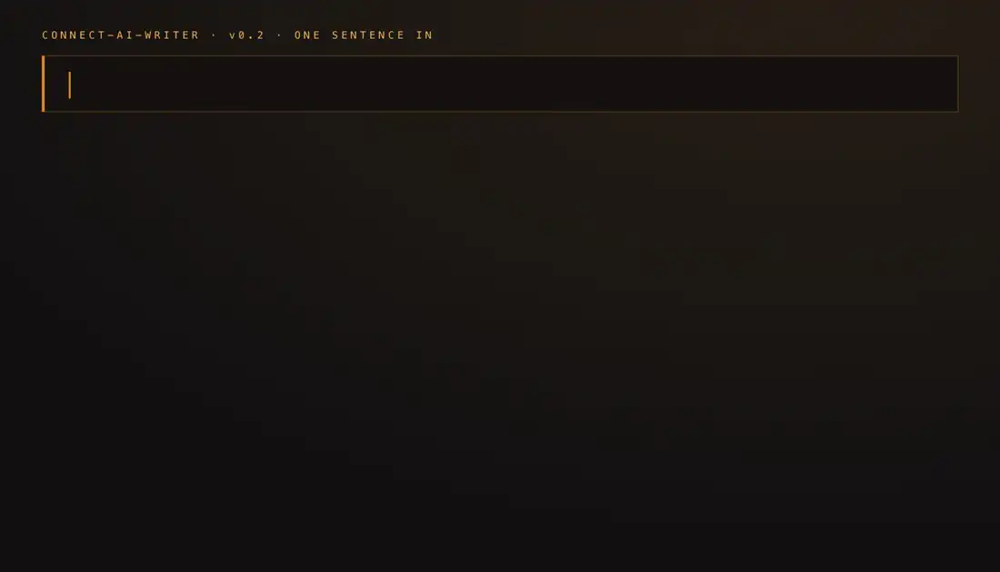
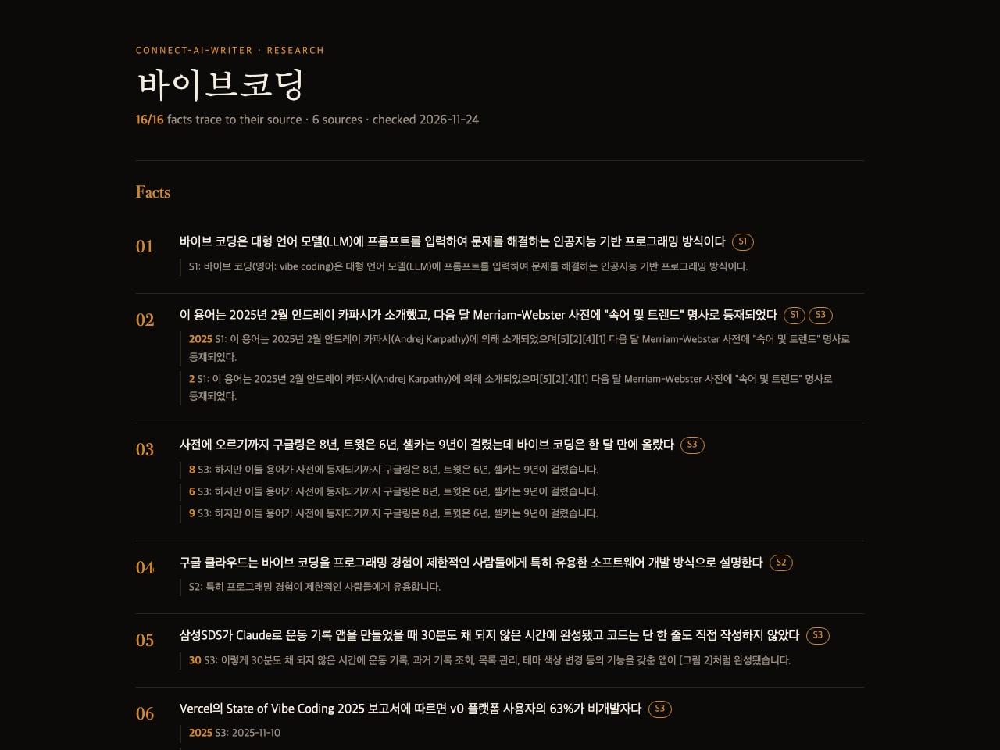
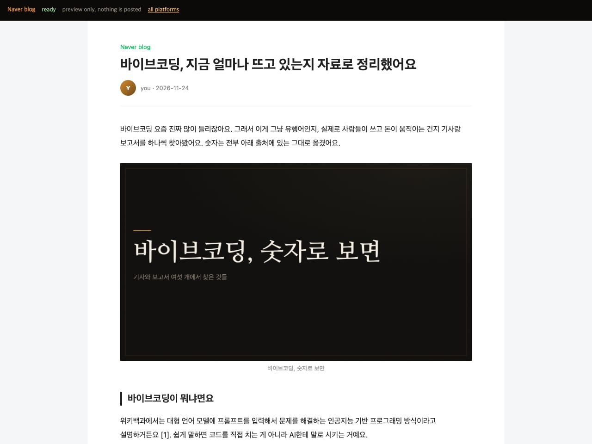
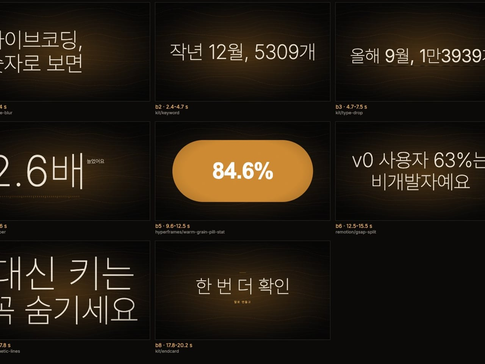

<p align="center"></p>

<p align="center">
  <b>CONNECT AI LAB</b> · 모두를 위한 AI 교육 · AI education for everyone<br>
  <a href="https://wonseokjung.github.io/connect-ai-writer/textbook/"><b>교재 보면서 따라 하기</b></a> · <a href="https://www.youtube.com/@CONNECT-AI-LAB">YouTube: CONNECT AI LAB</a> · <a href="https://www.aicitybuilders.com/vibecoding">강의: 비주얼 바이브코딩</a> · <a href="README.md">English</a>
</p>

# connect-ai-writer

**글 잘 쓰는 데 필요한 스킬을 다 모아 둔 AI 글쓰기 직원이에요. 한 문장만 말하면 트렌드 찾고, 자료 조사하고, 내 말투로 블로그 글을 사진까지 써 줘요. 아이 동화도 써 주고요.**

[](https://wonseokjung.github.io/connect-ai-writer/)

```bash
npx connect-ai-writer install-skill
```

그다음에 에이전트(Claude Code, Codex, Antigravity, Cursor)를 여시고 이렇게 말해 보세요. "요즘 뜨는 주제로 네이버 블로그 글 써 줘." 처음이시면 [교재](https://wonseokjung.github.io/connect-ai-writer/textbook/)에 복사해서 쓰는 프롬프트 8개를 순서대로 넣어 놨어요.

## 스킬

전부 제가 실제로 돌려서 나온 화면이에요.

<table>
<tr>
<td width="33%" valign="top"><br><b>트렌드 찾기</b><br><sub>"요즘 뜨는 거 찾아 줘." 구글 트렌드, 검색어 자동완성, 위키백과 조회수를 출처랑 날짜까지 붙여서 보여 줘요.</sub></td>
<td width="33%" valign="top"><br><b>자료 조사</b><br><sub>"자료 찾아서 정리해 줘." 기사랑 보고서를 읽고, 사실 하나하나가 어느 문장에서 왔는지 다 이어 줘요.</sub></td>
<td width="33%" valign="top"><br><b>플랫폼별 글</b><br><sub>네이버 블로그, 쓰레드, X, 링크드인, 인스타, 뉴스레터. 숫자는 출처에 있는 그대로만 써요.</sub></td>
</tr>
<tr>
<td width="33%" valign="top"><br><b>그림책 동화</b><br><sub>"7살, 공룡, 잠자리 동화 써 줘." 그림도 코드로 그려서 인쇄할 수 있는 PDF까지 나와요.</sub></td>
<td width="33%" valign="top"><br><b>AI 티 지우기</b><br><sub>번역투랑 AI 말버릇을 찾아서 표시해 주고, 고친 다음에 숫자 하나 안 바뀌었는지까지 확인해요.</sub></td>
<td width="33%" valign="top"><br><b>내 말투표</b><br><sub>내 영상 자막을 주면 내가 실제로 어떻게 말하는지 세어서 표로 만들어요. 글은 이 표대로 써요.</sub></td>
</tr>
<tr>
<td colspan="3"><b>우리 다른 AI 직원들이랑 같이 일해요</b></td>
</tr>
<tr>
<td width="33%" valign="top"><br><b>모션그래픽 영상</b> · <a href="https://github.com/wonseokjung/connect-ai-motion"><code>connect-ai-motion</code></a><br><sub>"이 글로 모션그래픽 영상도 만들어 줘." 쓴 글 그대로 가로, 세로 영상이 나와요. 84.6%는 84.6%로요.</sub></td>
<td width="33%" valign="top"><br><b>영상 하나로 다섯 군데</b><br><sub>제 강의 영상 하나로 쓰레드, 네이버, X, 링크드인, 인스타 글이랑 사진이 한 번에 나와요.</sub></td>
<td width="33%" valign="top"><br><b>임시저장까지만</b> · <a href="https://github.com/wonseokjung/connect-ai-marketer"><code>connect-ai-marketer</code></a><br><sub>Ego Lite로 글쓰기 화면에 채우고 임시저장까지만 해요. 발행은 직접 누르세요. 올리는 건 마케팅팀이 이어받아요.</sub></td>
</tr>
</table>

## 올리기 전에 이걸 잡아 줘요

- 출처에 없는 숫자, 바뀐 인용, 읽지도 않은 링크
- 플랫폼 글자 수 초과, 사진이 빠진 글, 검색어가 안 들어간 제목
- 번역투, AI 말버릇, 이모지, 꺾쇠 괄호

<!-- team:start -->
## CONNECT AI LAB의 AI 직원들

AI 직원을 하나씩 오픈소스로 만들고 있어요. 필요한 직원부터 데려가 쓰세요.

<table>
<tr><td width="34%" valign="top"><b>사업 해부 직원</b><br><a href="https://github.com/wonseokjung/reversebusiness"><code>reversebusiness</code></a></td><td valign="top">사업 웹사이트 주소 하나 주면 그 사업이 어떻게 돈 버는지 읽어 줘요.</td></tr>
<tr><td width="34%" valign="top"><b>영상 편집 직원</b><br><a href="https://github.com/wonseokjung/connect-ai-video-motion"><code>connect-ai-video-motion</code></a></td><td valign="top">내 영상을 주면 몸을 피해서 빈자리에 모션그래픽을 넣어 줘요.</td></tr>
<tr><td width="34%" valign="top"><b>모션그래픽 직원</b><br><a href="https://github.com/wonseokjung/connect-ai-motion"><code>connect-ai-motion</code></a></td><td valign="top">글 몇 줄 주면 모션그래픽 영상을 만들어 줘요. 찍은 영상은 없어도 돼요.</td></tr>
<tr><td width="34%" valign="top"><b>마케팅팀</b><br><a href="https://github.com/wonseokjung/connect-ai-marketer"><code>connect-ai-marketer</code></a></td><td valign="top">내 브라우저에서 24시간 댓글, 리스닝, 업로드를 맡아요.</td></tr>
<tr><td width="34%" valign="top"><b>글쓰기 직원</b> · <b>지금 보는 직원</b><br><a href="https://github.com/wonseokjung/connect-ai-writer"><code>connect-ai-writer</code></a></td><td valign="top">영상 하나 주면 플랫폼마다 내 말투로 글을 쓰고 사진까지 같이 만들어 줘요.</td></tr>
</table>
<!-- team:end -->

---

명령이랑 옵션은 [docs/guide.ko.md](docs/guide.ko.md)에 다 정리해 뒀어요. 계정 없이 먼저 보고 싶으시면 `npx connect-ai-writer demo` 해 보세요.

라이선스는 MIT예요. 같이 깔리는 패키지, 가져다 쓰는 프로그램, 방법을 배워 온 오픈소스는 [NOTICE.md](NOTICE.md)에 다 정리해 뒀어요.

이런 도구를 내 AI 에이전트로 직접 만드는 법은 [비주얼 바이브코딩](https://www.aicitybuilders.com/vibecoding)에서 알려 드려요.

<table><tr>
<td width="140" valign="top"></td>
<td valign="top"><b>만든 사람: AI 멘토 제이</b> · CONNECT AI LAB<br>
앞으로도 AI 직원을 하나씩 오픈소스로 풀 거예요. 만드는 법은 유튜브랑 강의에서 다 보여 드려요.<br>
<a href="https://www.youtube.com/@CONNECT-AI-LAB">유튜브</a> · <a href="https://www.aicitybuilders.com/vibecoding">비주얼 바이브코딩</a> · <a href="https://github.com/wonseokjung">다른 오픈소스</a></td>
</tr></table>
