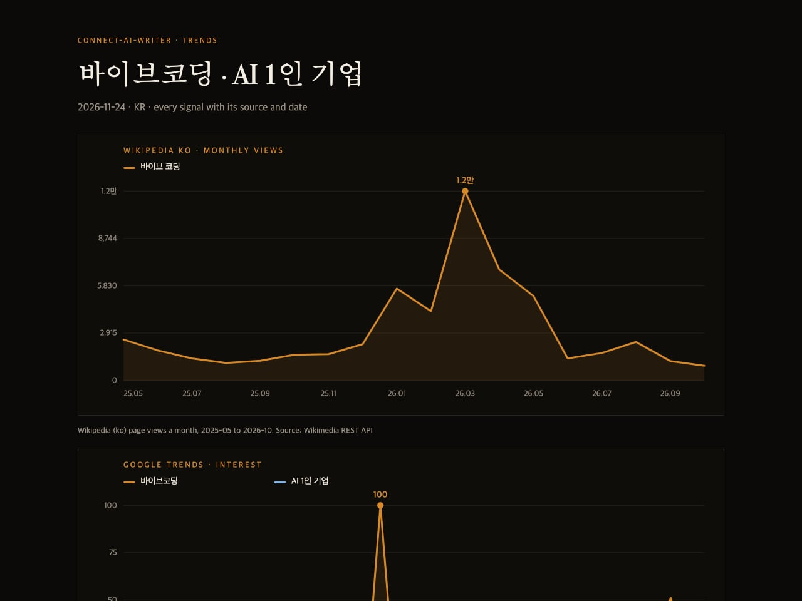
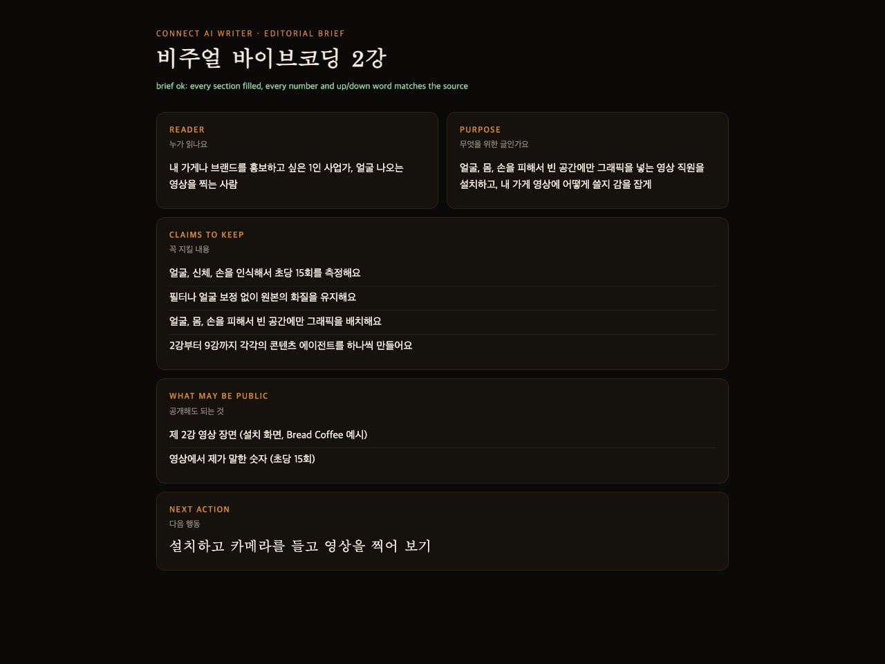
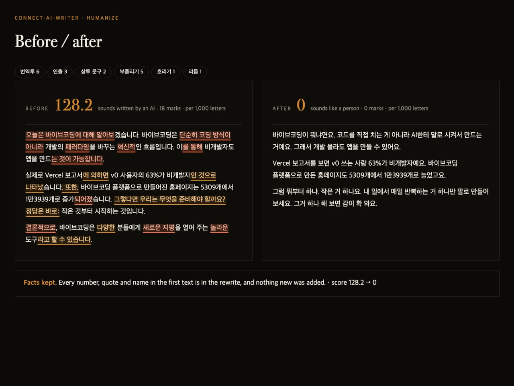
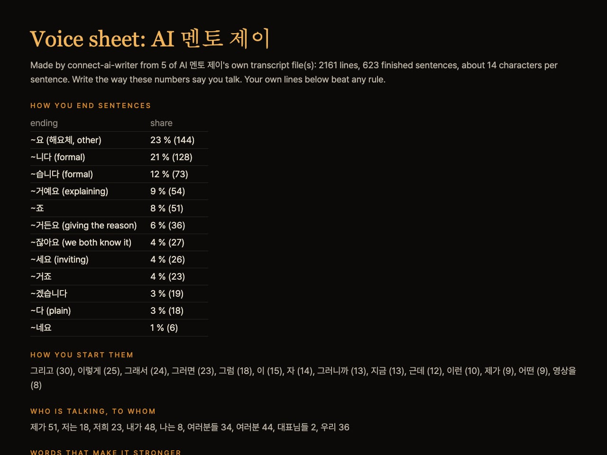
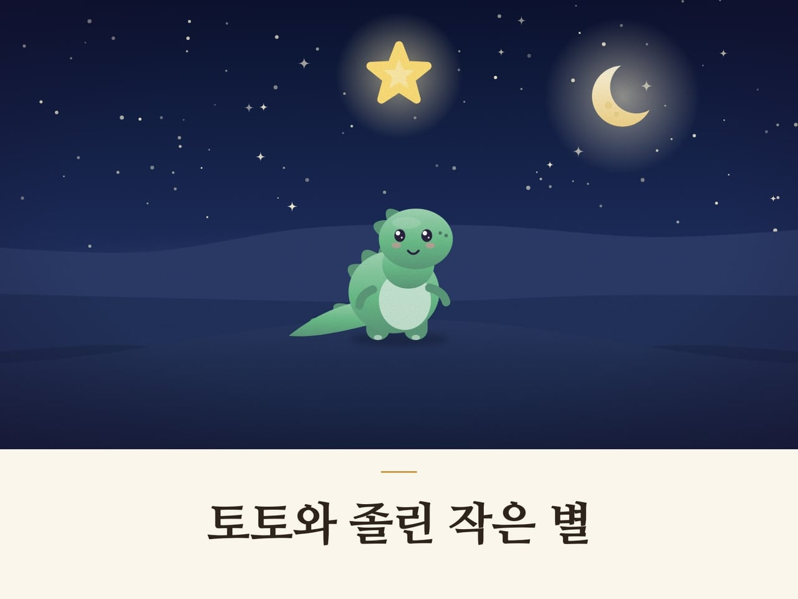
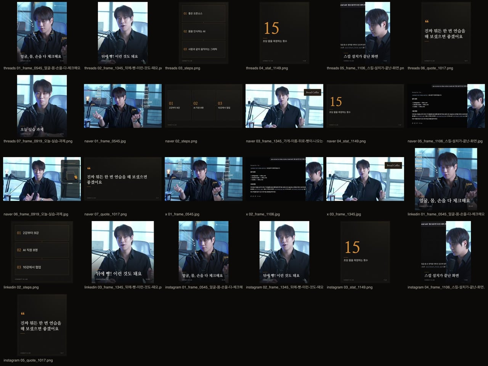
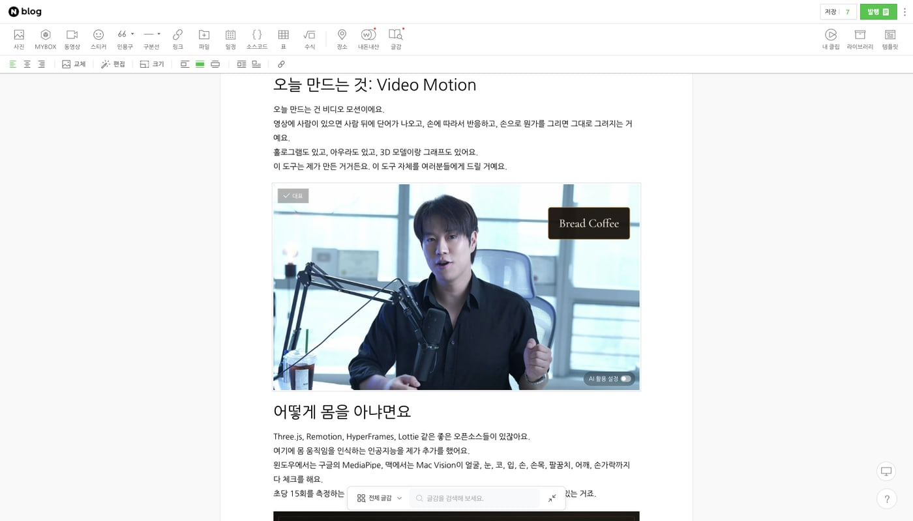
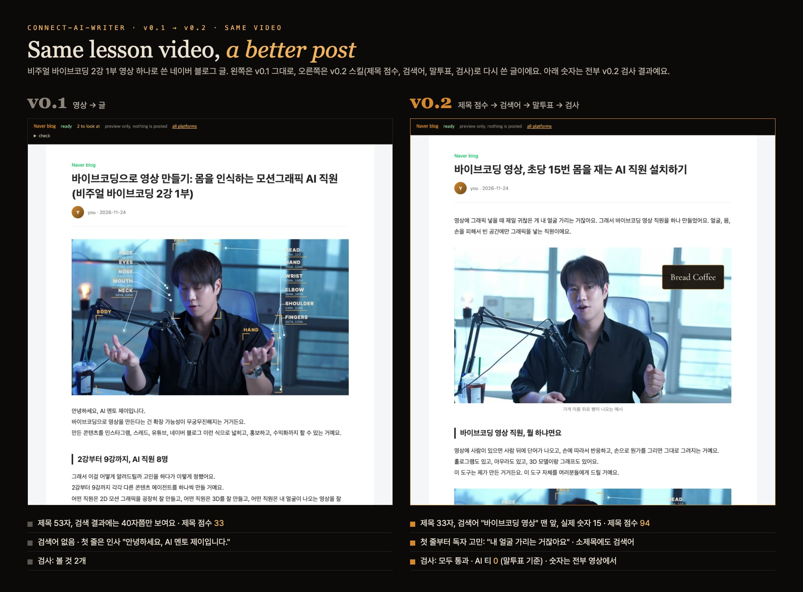

<p align="center"></p>

<p align="center">
  <b>CONNECT AI LAB</b> · 모두를 위한 AI 교육 · AI education for everyone<br>
  <a href="https://wonseokjung.github.io/connect-ai-writer/textbook/"><b>교재 보면서 따라 하기</b></a> · <a href="https://www.youtube.com/@CONNECT-AI-LAB">YouTube: CONNECT AI LAB</a> · <a href="https://www.aicitybuilders.com/vibecoding">강의: 비주얼 바이브코딩</a> · <a href="README.md">English</a>
</p>

# connect-ai-writer

**1인 사업가, 유튜버 여러분들을 위한 AI 글쓰기 직원이에요. 내 영상 하나만 주면 네이버 블로그, 쓰레드, 인스타 글을 내 말투로 써 주고, 사진까지 같이 만들어 줘요. 요즘 뜨는 주제 찾기, 자료 조사도 한 문장이면 돼요.**

[](https://wonseokjung.github.io/connect-ai-writer/)

```bash
npx github:wonseokjung/connect-ai-writer install-skill
```

설치는 이렇게 해요. 에이전트(Claude Code, Codex, Antigravity, Cursor) 채팅창에 위 한 줄을 그대로 붙여 넣고 설치해 달라고 하세요. 다 되면 새 채팅을 하나 여시고 이렇게 말해 보세요. "요즘 뜨는 주제로 네이버 블로그 글 써 줘." 처음이시면 [교재](https://wonseokjung.github.io/connect-ai-writer/textbook/)에 복사해서 쓰는 프롬프트를 순서대로 넣어 놨어요.

직접 깔아야 하는 건 [Node.js](https://nodejs.org) 20.19 이상이랑 코딩 에이전트뿐이에요. 터미널(명령어 치는 검은 창)은 몰라도 돼요, 에이전트가 대신 쳐 주거든요. 유료 API 키(돈 내고 받는 서비스 열쇠)도 필요 없어요.

<p align="center">
  &nbsp;
  &nbsp;
  &nbsp;
  <br>
  <sub><b>집현전 글쓰기 학사</b> (CONNECT AI HQ 픽셀 크루 공용): 인사 · 자료 조사 · 집필 · 완성 단계마다 귀엽게 움직이며 표정이 바뀌어요.</sub>
</p>

## 스킬

전부 제가 실제로 돌려서 나온 화면이에요.

<table>
<tr>
<td width="33%" valign="top"><br><b>트렌드 찾기</b><br><sub>"요즘 뜨는 거 찾아 줘." 구글 트렌드, 검색어 자동완성, 위키백과 조회수를 출처랑 날짜까지 붙여서 보여 줘요.</sub></td>
<td width="33%" valign="top"><br><b>자료 조사</b><br><sub>"자료 찾아서 정리해 줘." 기사랑 보고서를 읽고, 글에 쓸 숫자랑 사실마다 원문 어느 문장에서 나왔는지 출처를 붙여 줘요.</sub></td>
<td width="33%" valign="top"><br><b>플랫폼별 글</b><br><sub>네이버 블로그, 쓰레드, X, 링크드인, 인스타, 뉴스레터. 숫자는 출처에 있는 그대로만 써요.</sub></td>
</tr>
<tr>
<td width="33%" valign="top"><br><b>글 기획서</b> · v0.3<br><sub>쓰기 전에 한 장으로 정해요. 누가 읽는지, 뭘 위한 글인지, 꼭 지킬 내용, 공개해도 되는 것, 다음 행동. 제목이랑 글이 전부 이걸 따라가요.</sub></td>
<td width="33%" valign="top"><br><b>AI 티 지우기</b><br><sub>번역투랑 AI 말버릇을 찾아서 표시해 주고, 고친 다음에 숫자 하나 안 바뀌었는지까지 확인해요.</sub></td>
<td width="33%" valign="top"><br><b>내 말투표</b><br><sub>내 영상 자막을 주면 제가 자주 쓰는 말끝, 자주 쓰는 말, 절대 안 쓰는 말을 뽑아서 말투표로 만들어 줘요. 글은 전부 이 표대로 써요.</sub></td>
</tr>
<tr>
<td width="33%" valign="top"><br><b>보너스: 그림책 동화</b> (선택)<br><sub>"7살, 공룡, 잠자리 동화 써 줘." 그림도 코드로 그려서 인쇄할 수 있는 PDF까지 나와요.</sub></td>
<td colspan="2" valign="top"><b>사진은 이런 걸로 만들어요</b><br><sub>내 영상에서 고른 선명한 장면, 내가 한 말 그대로 넣은 인용 카드, 출처에 있는 숫자로 만든 숫자 카드랑 비교 카드, 내 페이지 캡처, 코드로 그린 그림이에요. 없는 사람, 없는 화면, 없는 숫자는 안 만들어요.</sub></td>
</tr>
<tr>
<td colspan="3"><b>우리 다른 AI 직원들이랑 같이 일해요</b></td>
</tr>
<tr>
<td width="33%" valign="top"><br><b>모션그래픽 영상</b> · <a href="https://github.com/wonseokjung/connect-ai-motion"><code>connect-ai-motion</code></a><br><sub>"이 글로 모션그래픽 영상도 만들어 줘." 쓴 글 그대로 가로, 세로 영상이 나와요. 84.6%는 84.6%로요.</sub></td>
<td width="33%" valign="top"><br><b>영상 하나로 다섯 군데</b><br><sub>제 강의 영상 하나로 쓰레드, 네이버, X, 링크드인, 인스타 글이랑 사진이 한 번에 나와요.</sub></td>
<td width="33%" valign="top"><br><b>임시저장까지만</b> · <a href="https://github.com/wonseokjung/connect-ai-marketer"><code>connect-ai-marketer</code></a><br><sub>CONNECT AI Browser(없으면 Ego Lite)로 글쓰기 화면에 채우고 임시저장까지만 해 줘요. 발행은 여러분들이 직접 누르시면 돼요. 올리는 건 마케팅팀이 이어받거든요.</sub></td>
</tr>
</table>

## v0.1 이랑 v0.2, 같은 영상으로 비교



제 2강 영상 하나로 쓴 네이버 블로그 글이에요. 실제 글 첫머리를 그대로 옮겨 볼게요.

- v0.1 제목: "바이브코딩으로 영상 만들기: 몸을 인식하는 모션그래픽 AI 직원 (비주얼 바이브코딩 2강 1부)"
- v0.1 첫 줄: "안녕하세요, AI 멘토 제이입니다." "바이브코딩으로 영상을 만든다는 건 확장 가능성이 무궁무진해지는 거거든요."
- v0.2 제목: "바이브코딩 영상, 초당 15번 몸을 재는 AI 직원 설치하기"
- v0.2 첫 줄: "영상에 그래픽 넣을 때 제일 귀찮은 게 내 얼굴 가리는 거잖아요." "그래서 바이브코딩 영상 직원을 하나 만들었어요."

v0.1은 제목이 길어서 검색 결과에서 잘리고, 어떤 검색어를 노리는 글인지 적는 줄(keyword)도 없었어요. v0.2는 검색어를 제목 맨 앞에 두고, 영상에서 제가 말한 숫자(초당 15번)를 제목에 넣어서 검사를 다 통과했거든요.

## 올리기 전에 이걸 봐 줘요

- 검색: 검색어가 제목 앞쪽에 있는지, 첫 문단이랑 소제목에 들어갔는지
- 플랫폼 규칙: 쓰레드 500자, X는 한글 140자 정도, 사진 장수, 첫 줄 길이
- 숫자: 글에 쓴 숫자, 인용, 늘었다 줄었다가 출처랑 똑같은지. 숫자랑 인용이랑 방향을 보는 거라서, 뜻까지 다 맞는지는 마지막에 직접 한 번 읽어 주세요.
- 내 말투: 번역투, AI 말버릇, 이모지, 꺾쇠 괄호

이 README도 이 도구로 직접 검사했어요. 1,000자 기준 AI 티 점수 0점이고, 고칠 것도 0개예요. 교재랑 사용 설명서도 똑같이 0개고요 (검사 명령: `node scripts/dogfood.mjs`).

## 결과는 어디에 있나요

`out/날짜_제목/` 폴더에 생겨요. 에이전트한테 "방금 만든 결과 폴더에서 index.html 열어 줘" 라고 하시면 플랫폼별 글이랑 사진이 한 화면에 열려요. 기본은 임시저장까지예요. "발행까지 해 줘" 라고 하시면 발행 버튼까지 눌러서 올려 줘요.

<!-- team:start -->
## CONNECT AI LAB의 AI 직원들

AI 직원을 하나씩 오픈소스로 만들고 있어요. 필요한 직원부터 데려가 쓰세요.

<table>
<tr><td width="34%" valign="top"><b>AI 사업 해부 직원</b><br><a href="https://github.com/wonseokjung/reversebusiness"><code>reversebusiness</code></a></td><td valign="top">사업 웹사이트 주소 하나 주면 그 사업이 어떻게 돈 버는지 읽어 줘요.</td></tr>
<tr><td width="34%" valign="top"><b>AI 영상 편집 직원</b><br><a href="https://github.com/wonseokjung/connect-ai-video-motion"><code>connect-ai-video-motion</code></a></td><td valign="top">내 영상을 주면 몸을 피해서 빈자리에 모션그래픽을 넣어 줘요.</td></tr>
<tr><td width="34%" valign="top"><b>AI 모션그래픽 직원</b><br><a href="https://github.com/wonseokjung/connect-ai-motion"><code>connect-ai-motion</code></a></td><td valign="top">글 몇 줄 주면 모션그래픽 영상을 만들어 줘요. 찍은 영상은 없어도 돼요.</td></tr>
<tr><td width="34%" valign="top"><b>AI 마케터 직원</b><br><a href="https://github.com/wonseokjung/connect-ai-marketer"><code>connect-ai-marketer</code></a></td><td valign="top">내 브라우저에서 24시간 댓글, 리스닝, 업로드를 맡아요.</td></tr>
<tr><td width="34%" valign="top"><b>AI 글쓰기 직원</b> · <b>지금 보는 직원</b><br><a href="https://github.com/wonseokjung/connect-ai-writer"><code>connect-ai-writer</code></a></td><td valign="top">영상 하나 주면 플랫폼마다 내 말투로 글을 쓰고 사진까지 같이 만들어 줘요.</td></tr>
</table>
<!-- team:end -->

---

명령이랑 옵션은 [docs/guide.ko.md](docs/guide.ko.md)에 다 정리해 뒀어요. 계정 없이 먼저 보고 싶으시면 `npx github:wonseokjung/connect-ai-writer demo` 해 보세요. 크롬이 없어도 글이랑 미리보기는 다 나와요.

라이선스는 MIT + Commons Clause예요. 코드는 다 공개돼 있는데(소스 공개), 판매는 안 되는 라이선스거든요. 내 사업, 내 채널에 마음껏 쓰고 고치고 나눠도 돼요. 이걸로 쓴 글도 다 여러분들 거예요. 안 되는 건 하나예요. 이 도구 자체를 돈 받고 팔거나, 값어치가 전부 또는 거의 이 도구에서 나오는 유료 서비스나 강의를 만들어서 파는 거요. 자세한 건 LICENSE를 보세요. 같이 깔리는 패키지, 가져다 쓰는 프로그램, 방법을 배워 온 오픈소스는 [NOTICE.md](NOTICE.md)에 다 정리해 뒀어요.

이런 도구를 내 AI 에이전트로 직접 만드는 법은 [비주얼 바이브코딩](https://www.aicitybuilders.com/vibecoding)에서 알려 드려요.

<table><tr>
<td width="140" valign="top"></td>
<td valign="top"><b>만든 사람: AI 멘토 제이</b> · CONNECT AI LAB<br>
앞으로도 AI 직원을 하나씩 오픈소스로 풀 거예요. 만드는 법은 유튜브랑 강의에서 다 보여 드려요.<br>
<a href="https://www.youtube.com/@CONNECT-AI-LAB">유튜브</a> · <a href="https://www.aicitybuilders.com/vibecoding">비주얼 바이브코딩</a> · <a href="https://github.com/wonseokjung">다른 오픈소스</a></td>
</tr></table>
