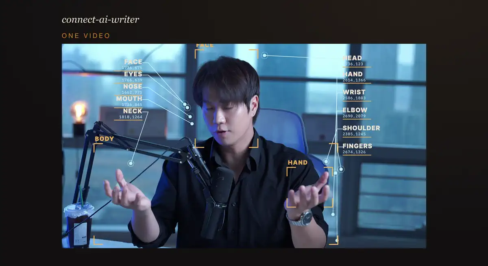
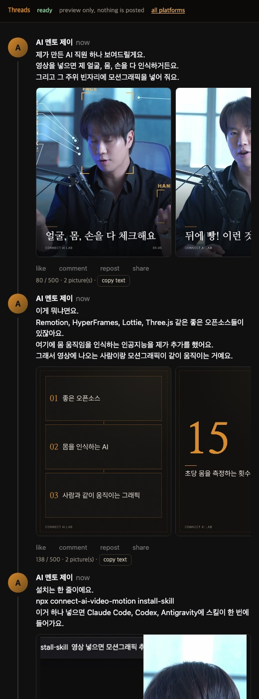
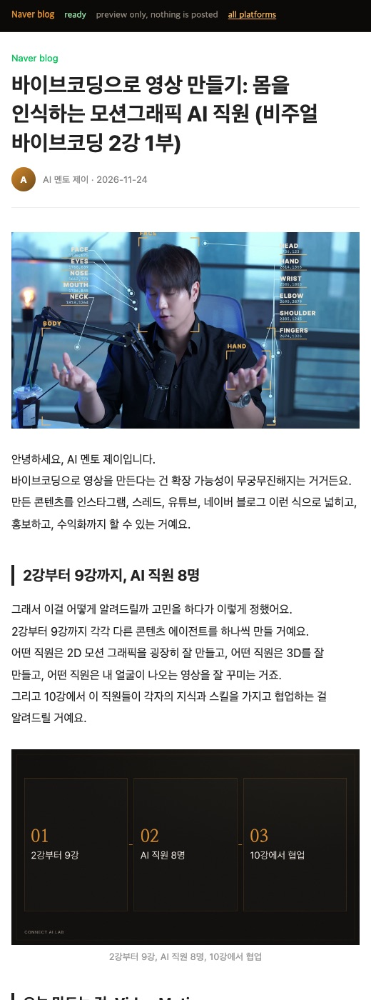

<p align="center"></p>

<p align="center">
  <b>CONNECT AI LAB</b> · AI education for everyone · 모두를 위한 AI 교육<br>
  <a href="https://www.youtube.com/@CONNECT-AI-LAB">YouTube: CONNECT AI LAB</a> · <a href="https://www.aicitybuilders.com/vibecoding">Course: Visual Vibe Coding</a> · <a href="README.ko.md">한국어</a>
</p>

# connect-ai-writer

**Your AI writing employee. Hand it one video, and it writes your Threads, Naver blog, X, LinkedIn and Instagram posts in your own voice, pictures included.**

[](https://wonseokjung.github.io/connect-ai-writer/)

## Start

```bash
npx connect-ai-writer install-skill
```

Then open your agent (Claude Code, Codex, Antigravity, Cursor) in the folder with your video and say "write a Threads post and a Naver blog post from this video".

## What you get

<table>
<tr>
<td width="33%" valign="top"><br><b>Threads</b><br><sub>A thread, with pictures that fill the frame.</sub></td>
<td width="33%" valign="top"><br><b>Naver blog</b><br><sub>Title, headings, a picture between paragraphs.</sub></td>
<td width="33%" valign="top"><br><b>X</b><br><sub>Korean letters count as 2 there. It counts for you.</sub></td>
</tr>
</table>

Real output from one of my lesson videos and its subtitles. Every picture comes from that video.

## What it catches before you post

- Numbers or quotes that aren't in your source
- Posts over the character limit, or with no picture
- AI-sounding phrases, emoji, corner brackets

`post` puts it in the editor through Ego Lite and saves a draft. The publish button is yours.

connect-ai-writer writes the posts and makes the pictures; the marketing employee [connect-ai-marketer](https://github.com/wonseokjung/connect-ai-marketer) handles the posting.

<!-- team:start -->
## CONNECT AI LAB's AI employees

I'm building AI employees one by one, in the open. Grab the one you need first.

<table>
<tr><td width="34%" valign="top"><b>Business analyst</b><br><a href="https://github.com/wonseokjung/reversebusiness"><code>reversebusiness</code></a></td><td valign="top">Give it a website, and it breaks down how that business makes money.</td></tr>
<tr><td width="34%" valign="top"><b>Video editor</b><br><a href="https://github.com/wonseokjung/connect-ai-video-motion"><code>connect-ai-video-motion</code></a></td><td valign="top">Give it your video, and it puts motion graphics in the empty space around you.</td></tr>
<tr><td width="34%" valign="top"><b>Motion designer</b><br><a href="https://github.com/wonseokjung/connect-ai-motion"><code>connect-ai-motion</code></a></td><td valign="top">Give it a few lines of text, and it makes a motion graphics video. No footage needed.</td></tr>
<tr><td width="34%" valign="top"><b>Marketing team</b><br><a href="https://github.com/wonseokjung/connect-ai-marketer"><code>connect-ai-marketer</code></a></td><td valign="top">Replies, social listening and uploads, 24/7 in your own browser.</td></tr>
<tr><td width="34%" valign="top"><b>Writer</b> · <b>this one</b><br><a href="https://github.com/wonseokjung/connect-ai-writer"><code>connect-ai-writer</code></a></td><td valign="top">Give it one video, and it writes a post for every platform in your voice, with pictures.</td></tr>
</table>
<!-- team:end -->

---

Every command is in [docs/guide.md](docs/guide.md). Want to try it without an account first? Run `npx connect-ai-writer demo`.

MIT. The packages it installs and the programs it calls keep their own licenses, listed in [NOTICE.md](NOTICE.md).

If you want to build tools like this with your own AI agent, I show you how in [Visual Vibe Coding](https://www.aicitybuilders.com/vibecoding).

<table><tr>
<td width="140" valign="top"></td>
<td valign="top"><b>Made by AI Mentor Jay</b> · CONNECT AI LAB<br>
I build AI employees like this one in the open, one by one, and show how on YouTube and in my course.<br>
<a href="https://www.youtube.com/@CONNECT-AI-LAB">YouTube</a> · <a href="https://www.aicitybuilders.com/vibecoding">Visual Vibe Coding</a> · <a href="https://github.com/wonseokjung">More open source</a></td>
</tr></table>
