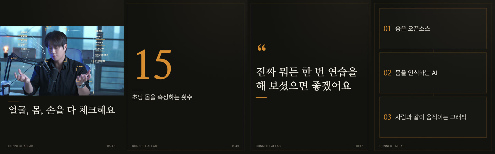
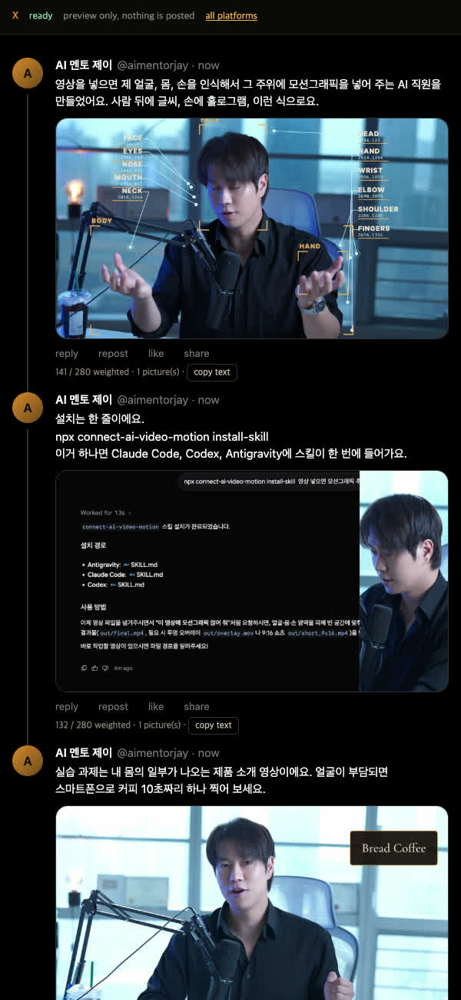
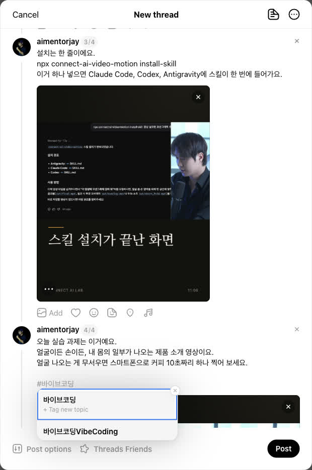
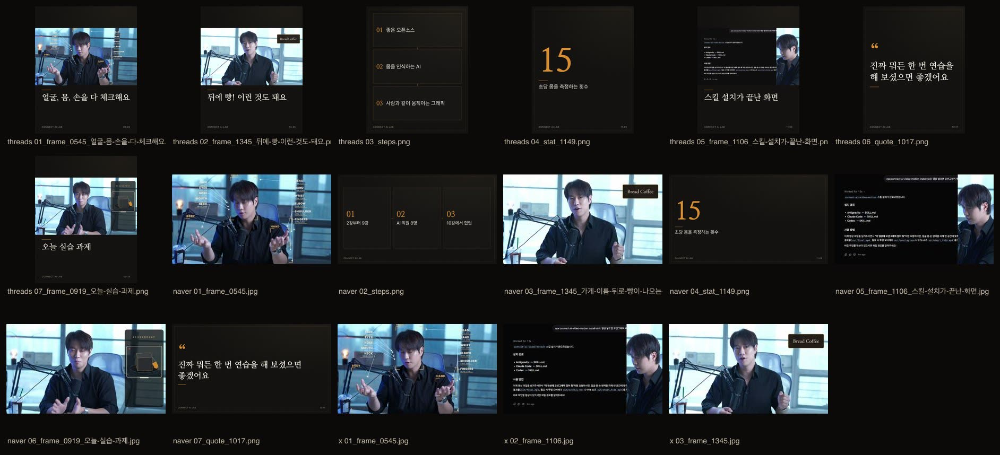

<!-- BANNER PLACEHOLDER: docs/brand/banner.jpg, the CONNECT AI LAB brand banner with Jay's real face (made by the lead from a real photo, never generated). Put it here as:
<p align="center"></p>
-->

<p align="center">
  <b>CONNECT AI LAB</b> · AI education for everyone · 모두를 위한 AI 교육<br>
  <a href="https://www.youtube.com/@CONNECT-AI-LAB">YouTube: CONNECT AI LAB</a> · <a href="https://www.aicitybuilders.com/vibecoding">Course: Visual Vibe Coding</a> · <a href="README.ko.md">한국어</a>
</p>

# connect-ai-writer

**Your AI writing employee. Give it one thing you made, a video, its subtitles or your notes, and it writes a post for every text platform in your own voice, with pictures from your real material.**



## Start

```bash
npx connect-ai-writer demo
```

Example notes become posts for Threads, Naver blog, X, LinkedIn and Instagram, with 20 pictures, and the preview opens. No account needed. You need Node.js 20.9 or newer and Chrome.

With your agent (Claude Code, Codex, Antigravity, Cursor):

```bash
npx connect-ai-writer install-skill
```

Open your agent in the folder with your video and say "write a Threads post and a Naver blog post from this video".

## What you get

<table>
<tr>
<td width="33%" valign="top"><br><b>Threads, as a thread</b><br><sub>Every post under 500 characters, pictures attached.</sub></td>
<td width="33%" valign="top"><br><b>Naver blog, long form</b><br><sub>Title, headings, a picture between paragraphs, tags.</sub></td>
<td width="33%" valign="top"><br><b>X, weighted length</b><br><sub>Korean letters count 2. It counts for you.</sub></td>
</tr>
<tr>
<td width="33%" valign="top"><br><b>In the editor, not posted</b><br><sub>Through Ego Lite: filled, saved as a draft, stopped before Post.</sub></td>
<td colspan="2" valign="top"><br><b>Every picture comes from your material</b><br><sub>Sharp frames of your video, your exact words, numbers you said, your own page. No made-up people, screens or numbers.</sub></td>
</tr>
</table>

## How it works

```bash
npx connect-ai-writer start my-video.mp4 --for threads,naver,x --voice voice.md
# your agent writes each post.md from brief.md
npx connect-ai-writer build
npx connect-ai-writer post --to threads        # fills the editor, saves a draft, does not post
```

| Step | What happens |
|---|---|
| `voice` | A voice sheet from your own transcripts: how you end sentences, how you start them, words you never say |
| `start` | Reads your source (video + .srt, .vtt, notes, YouTube link, your page), picks sharp frames, writes a brief |
| `build` | Pictures at each platform's size, check, `preview.html`, copy-ready `post.txt` |
| `check` | Fails on a number or quote that is not in your source, over the limit, AI-sounding phrases, emoji, corner brackets, long dashes, a post with no picture |
| `post` | Ego Lite fills the editor with your login and stops before Post. `--publish` only when you type it yourself |

Limits for every platform are in [platforms.json](platforms.json), with where each one came from. The ones marked `verified: false` were not on an official page, so check them again.

connect-ai-writer writes the words and pictures for each platform. Our marketing employee [connect-ai-marketer](https://github.com/wonseokjung/connect-ai-marketer) posts finished assets; `handoff/` has a file ready for it.

---

Every command is in [docs/guide.md](docs/guide.md). From a clone: `npm install`, then `npm test`.

MIT licence. The packages it installs and the programs it calls keep their own licences, listed in [NOTICE.md](NOTICE.md).

If you want to build tools like this with your own AI agent, I show you how in [Visual Vibe Coding](https://www.aicitybuilders.com/vibecoding).

<table><tr>
<td width="140" valign="top"></td>
<td valign="top"><b>Made by AI Mentor Jay</b> · CONNECT AI LAB<br>
I build AI employees like this one in the open, one by one, and show how on YouTube and in my course.<br>
<a href="https://www.youtube.com/@CONNECT-AI-LAB">YouTube</a> · <a href="https://www.aicitybuilders.com/vibecoding">Visual Vibe Coding</a> · <a href="https://github.com/wonseokjung">More open source</a></td>
</tr></table>

<!-- team:start -->
## CONNECT AI LAB's AI employees

I'm building AI employees one by one, in the open. Grab the one you need first.

<table>
<tr><td width="34%" valign="top"><b>Business analyst</b><br><a href="https://github.com/wonseokjung/reversebusiness"><code>reversebusiness</code></a></td><td valign="top">Give it a website, and it breaks down how that business makes money.</td></tr>
<tr><td width="34%" valign="top"><b>Video editor</b><br><a href="https://github.com/wonseokjung/connect-ai-video-motion"><code>connect-ai-video-motion</code></a></td><td valign="top">Give it your video, and it puts motion graphics in the empty space around you.</td></tr>
<tr><td width="34%" valign="top"><b>Motion designer</b><br><a href="https://github.com/wonseokjung/connect-ai-motion"><code>connect-ai-motion</code></a></td><td valign="top">Give it a few lines of text, and it makes a motion graphics video. No footage needed.</td></tr>
<tr><td width="34%" valign="top"><b>Marketing team</b><br><a href="https://github.com/wonseokjung/connect-ai-marketer"><code>connect-ai-marketer</code></a></td><td valign="top">Replies, social listening and uploads, 24/7 in your own browser.</td></tr>
<tr><td width="34%" valign="top"><b>Writer</b> · <b>this one</b><br><a href="https://github.com/wonseokjung/connect-ai-writer"><code>connect-ai-writer</code></a></td><td valign="top">Give it your video or notes, and it writes a post for every platform in your voice, with pictures.</td></tr>
</table>
<!-- team:end -->
