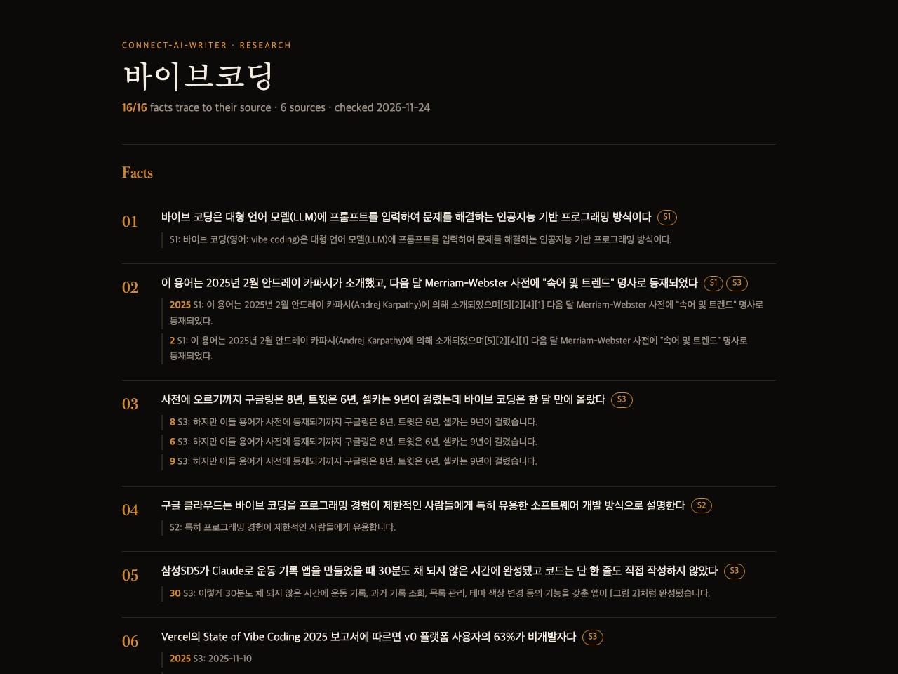
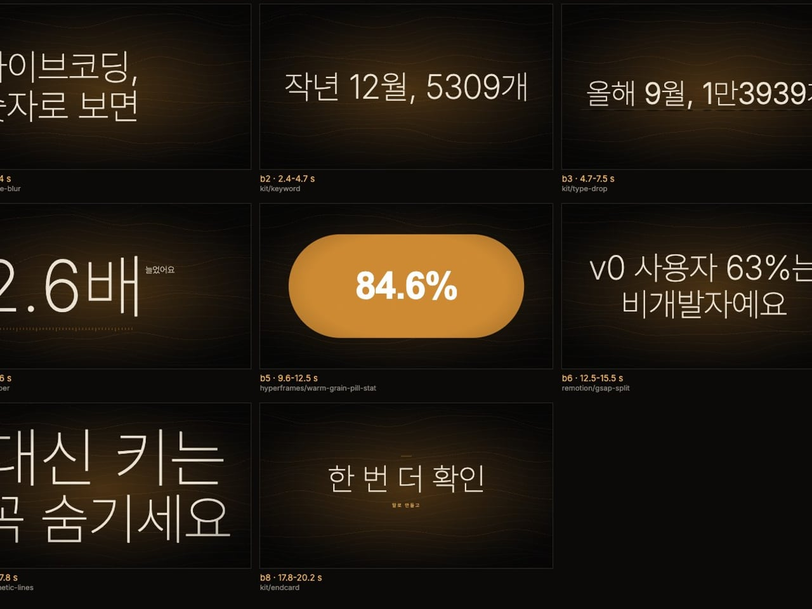

<p align="center"></p>

<p align="center">
  <b>CONNECT AI LAB</b> · AI education for everyone · 모두를 위한 AI 교육<br>
  <a href="https://wonseokjung.github.io/connect-ai-writer/textbook/?lang=en"><b>Follow the textbook</b></a> · <a href="https://www.youtube.com/@CONNECT-AI-LAB">YouTube: CONNECT AI LAB</a> · <a href="https://www.aicitybuilders.com/vibecoding">Course: Visual Vibe Coding</a> · <a href="README.ko.md">한국어</a>
</p>

# connect-ai-writer

**An AI writing employee with every skill a writer needs. Say one sentence, and it finds what is trending, researches it with sources, and writes your blog post in your own voice, pictures included. It writes your kid a picture book, too.**

[](https://wonseokjung.github.io/connect-ai-writer/)

```bash
npx connect-ai-writer install-skill
```

Then open your agent (Claude Code, Codex, Antigravity, Cursor) and say "find what is trending and write a blog post about it". New to this? The [textbook](https://wonseokjung.github.io/connect-ai-writer/textbook/?lang=en) has eight copy-and-paste prompts, in order.

## Skills

Every picture below is a real run.

<table>
<tr>
<td width="33%" valign="top"><br><b>Trends</b><br><sub>"What is hot right now?" Google Trends, search suggestions and Wikipedia views, each with its source and date.</sub></td>
<td width="33%" valign="top"><br><b>Research</b><br><sub>"Research this with sources." It reads articles and reports and ties every fact to the sentence it came from.</sub></td>
<td width="33%" valign="top"><br><b>Posts for every platform</b><br><sub>Naver blog, Threads, X, LinkedIn, Instagram, newsletters. Numbers only as the source has them.</sub></td>
</tr>
<tr>
<td width="33%" valign="top"><br><b>Picture books</b><br><sub>"A bedtime story, age 7, a dinosaur." Illustrations drawn in code, and a PDF you can print.</sub></td>
<td width="33%" valign="top"><br><b>Humanize</b><br><sub>Marks translationese and AI tells, then checks that the rewrite kept every number.</sub></td>
<td width="33%" valign="top"><br><b>Your voice sheet</b><br><sub>Give it your own subtitles and it counts how you really talk. Posts follow that sheet.</sub></td>
</tr>
<tr>
<td colspan="3"><b>Works with our other AI employees</b></td>
</tr>
<tr>
<td width="33%" valign="top"><br><b>Motion video</b> · <a href="https://github.com/wonseokjung/connect-ai-motion"><code>connect-ai-motion</code></a><br><sub>"Make a motion video from this post." Landscape and vertical, from the post's own words. 84.6% stays 84.6%.</sub></td>
<td width="33%" valign="top"><br><b>One video, five platforms</b><br><sub>One of my lesson videos in; Threads, Naver, X, LinkedIn and Instagram posts with pictures out.</sub></td>
<td width="33%" valign="top"><br><b>Drafts only</b> · <a href="https://github.com/wonseokjung/connect-ai-marketer"><code>connect-ai-marketer</code></a><br><sub>It fills the editor through Ego Lite and saves a draft. Publishing is your click. The marketing team takes it from there.</sub></td>
</tr>
</table>

## What it catches before you post

- Numbers that are not in the source, changed quotes, links it never read
- Posts over the limit, posts with no picture, titles without the search word
- Translationese, AI tells, emoji, corner brackets

<!-- team:start -->
## CONNECT AI LAB's AI employees

I'm building AI employees one by one, in the open. Grab the one you need first.

<table>
<tr><td width="34%" valign="top"><b>Business analyst</b><br><a href="https://github.com/wonseokjung/reversebusiness"><code>reversebusiness</code></a></td><td valign="top">Give it a website, and it breaks down how that business makes money.</td></tr>
<tr><td width="34%" valign="top"><b>Video editor</b><br><a href="https://github.com/wonseokjung/connect-ai-video-motion"><code>connect-ai-video-motion</code></a></td><td valign="top">Give it your video, and it puts motion graphics in the empty space around you.</td></tr>
<tr><td width="34%" valign="top"><b>Motion designer</b><br><a href="https://github.com/wonseokjung/connect-ai-motion"><code>connect-ai-motion</code></a></td><td valign="top">Give it a few lines of text, and it makes a motion graphics video. No footage needed.</td></tr>
<tr><td width="34%" valign="top"><b>Marketing team</b><br><a href="https://github.com/wonseokjung/connect-ai-marketer"><code>connect-ai-marketer</code></a></td><td valign="top">Replies, social listening and uploads, 24/7 in your own browser.</td></tr>
<tr><td width="34%" valign="top"><b>Writer</b> · <b>this one</b><br><a href="https://github.com/wonseokjung/connect-ai-writer"><code>connect-ai-writer</code></a></td><td valign="top">Give it one video, and it writes a post for every platform in your voice, with pictures.</td></tr>
</table>
<!-- team:end -->

---

Every command is in [docs/guide.md](docs/guide.md). Want to try it without an account first? Run `npx connect-ai-writer demo`.

MIT. The packages it installs, the programs it calls and the open source it learned methods from are listed in [NOTICE.md](NOTICE.md).

If you want to build tools like this with your own AI agent, I show you how in [Visual Vibe Coding](https://www.aicitybuilders.com/vibecoding).

<table><tr>
<td width="140" valign="top"></td>
<td valign="top"><b>Made by AI Mentor Jay</b> · CONNECT AI LAB<br>
I build AI employees like this one in the open, one by one, and show how on YouTube and in my course.<br>
<a href="https://www.youtube.com/@CONNECT-AI-LAB">YouTube</a> · <a href="https://www.aicitybuilders.com/vibecoding">Visual Vibe Coding</a> · <a href="https://github.com/wonseokjung">More open source</a></td>
</tr></table>
